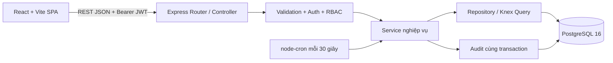
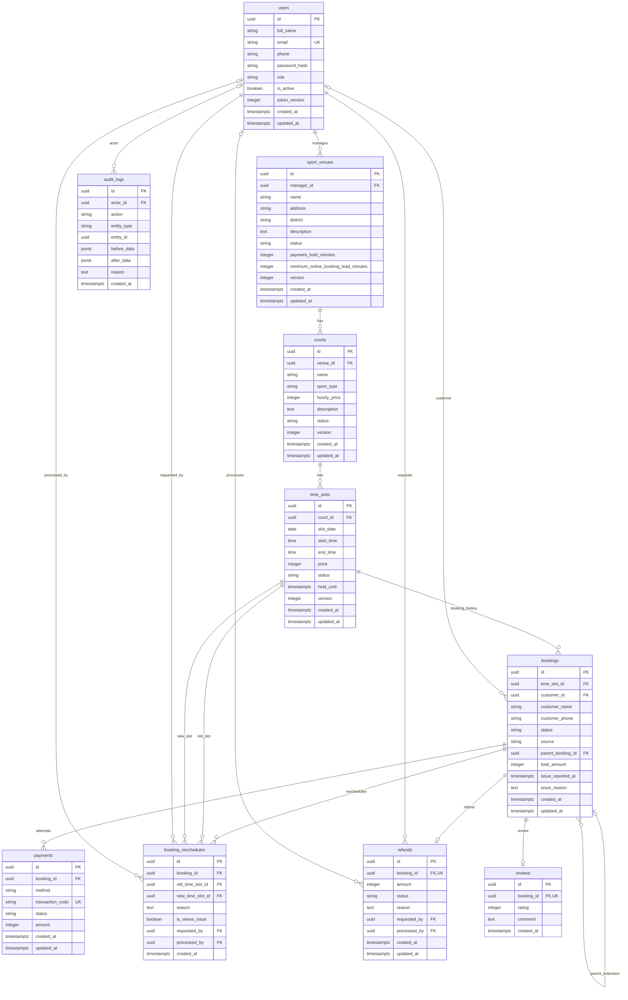
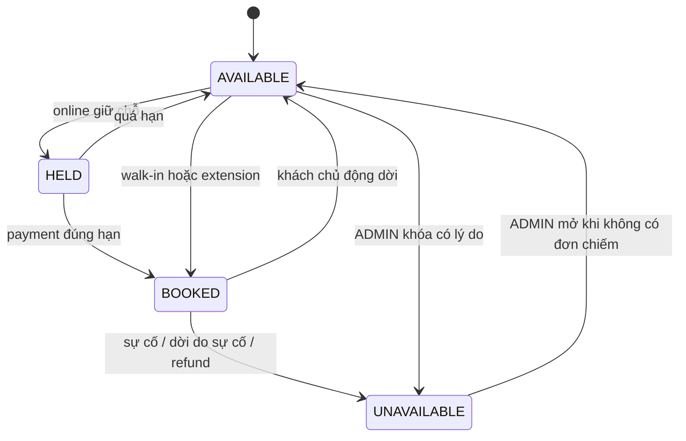
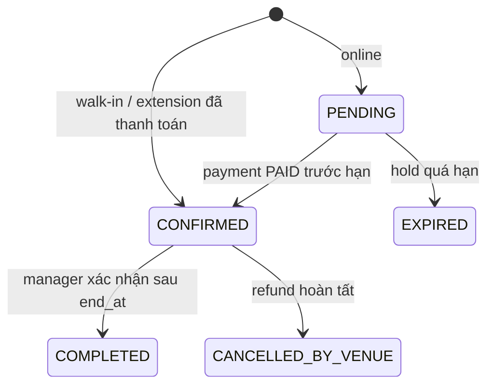
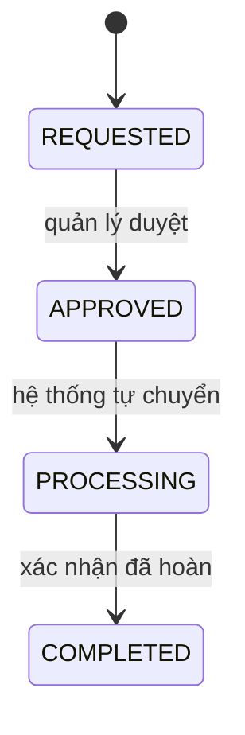

# Kiến trúc và quy tắc dữ liệu

## 1. Ranh giới hệ thống

Frontend phụ trách hiển thị, điều hướng và phản hồi lỗi; server quyết định quyền truy cập, deadline và chuyển trạng thái. Service mở transaction bao trọn nghiệp vụ; repository/query không commit riêng một phần thao tác. API luôn trả `server_time` để client đồng bộ đồng hồ.

Đơn vị tiền: integer VND. ID: UUID. `slot_date` và `start_time/end_time` là ngày/giờ địa phương `Asia/Ho_Chi_Minh`. Server dựng mốc thời gian bằng `(slot_date + start_time) AT TIME ZONE 'Asia/Ho_Chi_Minh'`, không phụ thuộc timezone của máy Node hoặc container. `held_until` và cột audit là `timestamptz`.

## 2. Thay đổi so với PDF

- Không có API, cron hoặc UI sinh lịch tự động; khung cố định 06:00–22:00, ca 60 phút. Seed chỉ nạp dữ liệu demo hữu hạn.
- Manager sửa metadata cơ sở/sân của mình. Chỉ ADMIN đổi trực tiếp trạng thái venue/court/slot, có lý do và audit. Luồng sự cố của manager vẫn được cho phép vì đó là nghiệp vụ có kiểm soát và truy vết.
- Bổ sung `version` cho venue/court/slot, `token_version` cho user và `audit_logs`. Bảng audit là bảng thứ 10 để đáp ứng ảnh, không phải sai lệch bỏ sót yêu cầu 9 bảng gốc.
- Dời lịch cùng cơ sở, cùng môn, cùng giá. Không có xử lý chênh lệch tiền trong base.
- Không xóa vật lý danh mục có lịch sử; dùng trạng thái ngưng phục vụ.
- Giá metadata court không tự cập nhật giá slot đã seed; sân mới chưa có lịch. Cần quy trình import/migration có kiểm soát khi mở rộng dữ liệu cố định.

## 3. ERD — 10 bảng

Ảnh bàn giao: [erd.png](erd.png). Nguồn có thể nhập vào công cụ DBML: [erd.dbml](erd.dbml). Migration là nguồn thực thi ràng buộc PostgreSQL, bao gồm partial index và exclusion constraint không thể hiện đầy đủ trong sơ đồ.

Walk-in không bắt buộc tài khoản khách: `customer_id` có thể null, có `customer_name/customer_phone`. Online bắt buộc `customer_id`. Gia hạn tạo đơn mới và `parent_booking_id` trỏ đơn gốc; không kéo dài trực tiếp slot gốc.

### Ràng buộc đáng chú ý

| Bảng | Ràng buộc |
|---|---|
| users | Email duy nhất, lowercase; role hợp lệ; token_version không âm |
| sport_venues | Hold integer 1–10; lead time integer 10–1440; version >= 1 |
| courts | UNIQUE(venue_id,name); giá không âm; sport_type/status hợp lệ |
| time_slots | 60 phút, bắt đầu tròn giờ trong 06–22; end > start; giá không âm; chống overlap bằng GiST |
| time_slots | HELD luôn có held_until; các trạng thái khác không có held_until |
| bookings | Một slot tối đa một đơn PENDING/CONFIRMED/COMPLETED bằng partial unique index |
| payments | transaction_code duy nhất; một PAID payment/booking bằng partial unique index |
| booking_reschedules | old_slot khác new_slot; FK đủ hai slot và actor |
| refunds | booking_id duy nhất, trạng thái thuộc đúng bốn bước |
| reviews | booking_id duy nhất; rating integer 1–5 |

`bookings_one_active_per_slot` vẫn tính COMPLETED để lịch sử slot đã dùng không thể bán lại. Booking EXPIRED hoặc đã dời đi không chiếm slot cũ. Quyền sở hữu và chuyển trạng thái hợp lệ được kiểm tra ở service; CHECK ở DB là lớp bảo vệ bổ sung.

## 4. Vòng đời trạng thái

Venue/court dùng `ACTIVE / INACTIVE / MAINTENANCE`. Manager không được gửi trạng thái qua PATCH metadata. ADMIN ngưng/bảo trì chỉ khi không còn đơn PENDING/CONFIRMED chưa kết thúc; nếu có thì trả 409 để xử lý nghiệp vụ trước.

Các thay đổi nghiệp vụ vẫn phải chạy kiểm tra và khóa dòng dù không phải thao tác đổi trạng thái trực tiếp của admin. Complete giữ slot BOOKED, không mở lịch đã dùng.

Dời lịch giữ booking CONFIRMED và thay `time_slot_id`; lịch sử lưu trong booking_reschedules. Sự cố dùng `issue_reported_at/issue_reason`, không tự thêm booking status ngoài contract.

APPROVED và PROCESSING được ghi audit trong cùng transaction duyệt, nên response thường hiển thị PROCESSING. Nhật ký vẫn chứng minh đủ chuỗi; không cho nhảy cóc hoặc quay lui.

## 5. Chống xung đột và tính toàn vẹn

### Hai cơ chế phục vụ hai vấn đề

`expected_version` tránh lost update khi hai người cùng sửa thông tin. Ví dụ hai tab cùng đọc version 2: tab A PATCH thành công và tăng lên 3; tab B PATCH với expected_version 2 nhận 409, không ghi đè dữ liệu A. Client tải lại, hiển thị dữ liệu mới rồi để người dùng quyết định sửa tiếp.

Khóa dòng trong transaction bảo vệ giữ chỗ/booking/payment/sự cố khỏi race condition. Version ở giao diện không thay thế khóa nghiệp vụ.

### Thứ tự khóa chung

Mọi luồng đều khóa theo cùng thứ tự:

1. Các venue theo UUID tăng dần.
2. Các court theo UUID tăng dần.
3. Các slot theo UUID tăng dần.
4. Booking, rồi payment/refund liên quan.

Đọc tham chiếu booking/slot trước để xác định court; sau khi có khóa slot, đọc lại và khóa booking. Nếu booking đã dời sang slot khác, trả 409 để client thử lại; không cập nhật trên giả định cũ. Đây là lý do không khóa booking trước rồi mới đi khóa venue/court.

Thao tác admin khóa sân dùng cùng khóa venue/court với booking. Kiểm tra venue/court ACTIVE phải diễn ra sau khi đã khóa, tránh kiểm tra ACTIVE xong sân bị đóng trước khi tạo đơn. Nhiều slot khi dời lịch luôn khóa theo thứ tự UUID để giảm deadlock.

### Atomic và idempotent

- Giữ chỗ: UPDATE chỉ khi AVAILABLE, kiểm tra kết quả, tạo PENDING trong cùng transaction.
- Thanh toán: khóa và kiểm tra chủ đơn/deadline; PAID/CONFIRMED/BOOKED commit cùng nhau. Callback sandbox lặp cùng transaction_code không ghi trùng.
- Cron: recheck HELD và held_until sau khi khóa; đổi booking EXPIRED và slot AVAILABLE cùng transaction. Không mở lại slot UNAVAILABLE.
- Walk-in: cho phép ca đang chạy nhưng chưa kết thúc; thanh toán tại quầy và BOOKED cùng transaction.
- Complete: chỉ sau end_at; gọi lại COMPLETED trả thành công.
- Dời lịch: khóa cả hai slot, xác minh đích còn trống và tương thích, cập nhật booking và lịch sử cùng transaction. Lỗi bất kỳ bước nào rollback hết.
- Refund: khóa đơn/slot/refund/payment, kiểm tra thứ tự bước; hoàn tất đổi toàn bộ dữ liệu cùng transaction.
- Metadata/status và audit cùng transaction: không có thay đổi thành công mà thiếu nhật ký bắt buộc.

## 6. Quyền truy cập và bảo mật

| Actor | Phạm vi |
|---|---|
| CUSTOMER | Tìm sân, đặt online, payment demo, đọc/dời đơn của mình, yêu cầu refund khi có sự cố, review đơn COMPLETED |
| VENUE_MANAGER | Metadata và giao dịch trong cơ sở có manager_id của mình; walk-in, complete, extend, sự cố và refund |
| ADMIN | Quản trị toàn hệ thống, thay trạng thái trực tiếp có lý do, xem audit |

Server truy ngược booking → slot → court → venue khi kiểm tra manager. Không tin `venue_id` hoặc `manager_id` gửi từ client. ADMIN được bỏ qua ownership nhưng vẫn phải tuân thủ ràng buộc nghiệp vụ, version và audit.

Mật khẩu băm bcryptjs; JWT có hạn, có token_version để logout/khóa tài khoản thu hồi quyền; mọi request được xác thực lại trạng thái user. Zod kiểm tra body/query/params; các trường nhạy cảm/ngoài whitelist không được mass assign. Knex dùng tham số query thay nối SQL từ input. CORS chỉ cho origin cấu hình, Helmet đặt HTTP security headers, body JSON giới hạn 64 KB. Các route auth có giới hạn 100 request/15 phút/IP. Không đưa password hash/token vào phản hồi hoặc audit.

Sandbox confirm được bảo vệ bằng auth, ownership và cờ môi trường. Trước production phải thay bằng tích hợp thanh toán có xác minh chữ ký, replay protection, đối soát và chính sách vận hành. API demo không xác minh việc chuyển tiền thật.

## 7. Hướng mở rộng

Chốt chính sách nạp lịch cố định dài hạn; phân trang/search/index phù hợp quy mô; đưa workflow hoàn tiền thật và thông báo sang worker có retry; bổ sung rate limit theo nghiệp vụ, quản lý secret, backup/restore, log có request ID và metrics. Các phần này không thay đổi quyền sở hữu và thứ tự khóa đã thống nhất.
